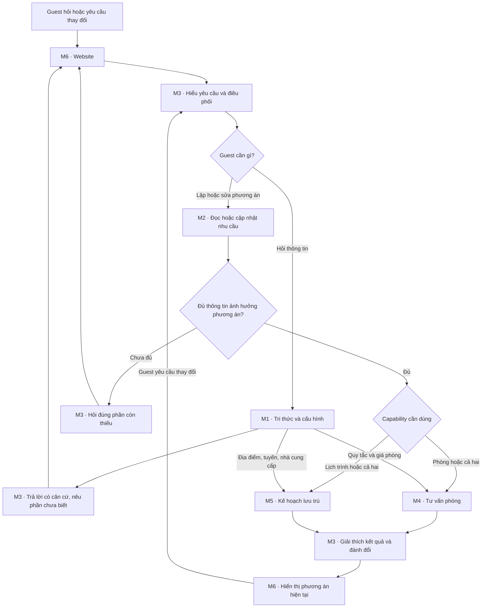

# Kiến trúc và workflow AI bắt buộc — Staylead Platform

Kiến trúc do Hieu xác nhận ngày 2026-10-22. Áp dụng cho mọi logic AI mới hoặc sửa đổi, kể cả sprint đầu, spike và test implementation. Đây là yêu cầu thiết kế, không phải mô tả tính năng đã có.
Không tự thay kiến trúc để tiện triển khai. Nếu phát hiện xung đột thực với AC, nêu rõ và xin quyết định thay đổi; không tạo vòng phê duyệt cho việc triển khai đúng kiến trúc.

## 1. Trách nhiệm sáu module

| Module | Trách nhiệm | Vị trí mã nguồn chính |
|---|---|---|
| M1 — Tri thức và cấu hình | Cấu hình khách sạn; nguồn được duyệt, scope, provenance và độ mới; truy xuất thông tin | `platform/knowledge`; schema/policy Hospitality trong `domains/hospitality` |
| M2 — Hồ sơ nhu cầu | Nguồn state chính thức của phiên/nhu cầu; cập nhật có kiểm soát, phiên bản và trạng thái kết quả | `platform/guest_context`; schema nghiệp vụ trong `domains/hospitality/schemas` |
| M3 — Điều phối hội thoại | Hiểu một/nhiều ý, dùng context, hỏi phần thiếu, gọi capabilities, tổng hợp và giải thích | `platform/conversation`; prompts/tools nghiệp vụ trong `domains/hospitality` |
| M4 — Tư vấn phòng | Phân phòng, kiểm ràng buộc, tính chi phí và so sánh phương án | `domains/hospitality/rooms`, `policies`, `recommendations` |
| M5 — Kế hoạch lưu trú | Lập/sửa ăn uống, nghỉ ngơi, tham quan, phương tiện; kiểm thời gian và ngân sách | `domains/hospitality/stay` và tools/policies liên quan |
| M6 — Website | Nhận yêu cầu, hiển thị trạng thái/phương án hiện tại; chọn, sửa, sao chép và mở liên kết được duyệt | `apps/web/src/shared`, `experiences`, `domains/hospitality`; API tại `entrypoints` |

Các đường dẫn backend trong bảng tính từ `apps/api/src/staylead_platform/`.
Sáu module là ranh giới trách nhiệm trong modular monolith, không bắt buộc sáu service, agent hoặc model call.

## 2. Workflow nghiệp vụ phải giữ

- Câu hỏi đơn giản đi thẳng M6 → M3 → M1 → M3 → M6; không bắt khai hồ sơ chuyến đi hoặc gọi M4/M5.
- Một lượt có thể vừa hỏi thông tin vừa thay đổi nhu cầu. Trả lời phần có căn cứ và xử lý thay đổi cần thiết; không ép chọn một intent duy nhất.
- M2 giữ nhu cầu chính thức; M3 hiểu và đề xuất patch. Dữ kiện quan trọng không chỉ nằm trong transcript; đề xuất AI không tự trở thành state đã commit.
- Chỉ hỏi thông tin thiếu có ảnh hưởng đến kết quả. Giữ các điều kiện còn đúng khi guest sửa yêu cầu.
- M4/M5 chịu trách nhiệm tính khả thi; M3 không tự bỏ ràng buộc để diễn giải phương án hấp dẫn hơn.
- Thiếu dữ liệu hoặc không khả thi phải nêu nguyên nhân và bước tiếp theo. Nới điều kiện bắt buộc cần guest đồng ý.
- Khi thay đổi nhu cầu, cập nhật state hợp lệ trước khi tính kết quả phụ thuộc nó; chỉ tính lại phần bị ảnh hưởng và đánh dấu kết quả cũ hết hiệu lực khi cần.

## 3. Ranh giới mã nguồn và quyền thực thi

- Module trao đổi qua typed contracts: nhu cầu, nguồn, yêu cầu xử lý, kết quả, vi phạm, chi phí và unknown. Không ghi trực tiếp state nội bộ của module khác.
- Shared `platform` không import `domains/hospitality`. Composition đăng ký domain schemas, validators, prompts, tools và capabilities qua contracts.
- Nghiệp vụ, catalog, prompts và tools Hospitality thuộc domain Hospitality. Dữ liệu runtime đi qua M1/storage theo scope; fixture chỉ là dữ liệu mẫu có nhãn. Đổi market thay phần domain, không sửa core để nhúng luật market mới.
- Frontend dùng khung chung và đăng ký landing/content/assets/theme/result renderers theo domain. Không hardcode Hospitality vào shared chat.
- Backend xác định và kiểm scope hotel/session. Retrieval chỉ đưa nguồn được phép, đúng hotel và còn hiệu lực vào context; nội dung nguồn không phải chỉ dẫn cấp quyền.
- AI đề xuất typed actions; server kiểm schema, quyền, scope, version và allowed tools trước thực thi. Không cho arbitrary SQL/HTTP hoặc tự đặt phòng, thanh toán, gửi thông báo.
- M3 có một orchestrator có giới hạn step/retry/time/context. Không mặc định dùng multi-agent, rewrite/rerank/critic/repair riêng cho mọi lượt; chỉ bổ sung khi AC hoặc evidence yêu cầu.
- `platform/ai_runtime` lo structured I/O, execution và usage qua provider-neutral port; transport/SDK ở infrastructure adapter. Không đặt điều phối nghiệp vụ trong provider adapter hoặc API handler.
- Runtime mục tiêu: Foundry Grok `grok-4-1-fast-reasoning`; deployment, endpoint và credentials cấu hình server-side. Thay provider không sửa domain/orchestrator; không mặc định tương thích mọi API/setting.
- AI xử lý ngôn ngữ từ yêu cầu/context, không giới hạn runtime vào vi/en hoặc enum đóng. Bảo toàn IDs, số liệu, điều kiện, ngày giờ và approved URLs; mơ hồ có ảnh hưởng phải làm rõ.
- Trả lời dựa trên evidence và kết quả tool thực; tách supported/unknown/conflict. Kiểm số liệu, trạng thái và nguồn tham chiếu; citation tồn tại chưa tự chứng minh nội dung đúng. Lỗi chỉ được repair có giới hạn hoặc trả phần an toàn, không bịa kết quả.

## 4. Hiệu quả sử dụng Azure LLM

- Một bước/module trong workflow không đồng nghĩa một LLM call. Gộp các nhiệm vụ AI tương thích trong cùng call khi vẫn đáp ứng AC; chỉ thêm call khi cần evidence/tool result hoặc xử lý lỗi thực tế.
- Truy xuất và lọc đúng scope trước khi đưa evidence vào model; chỉ gửi facts và context liên quan, không toàn catalog/transcript. Không cắt mất điều kiện bắt buộc hoặc evidence cần cho các ý trong câu hỏi.
- Kiểm schema, quyền, số liệu, IDs, trạng thái và URL bằng code khi có thể; không mặc định thêm LLM router, dịch thuật riêng, critic hoặc judge cho mỗi request.
- Áp dụng giới hạn context/output/steps/retries và timeout qua toàn turn. Không để retry nhiều tầng nhân số calls; dừng khi lỗi không thể retry, request bị huỷ hoặc đã hết giới hạn.
- Theo dõi calls và token usage khi provider cấp; không suy ra giảm chi phí từ số calls đơn thuần, không coi app limits là hard cap hoá đơn Azure.
- Cache hoặc xử lý trước chỉ bổ sung khi có nhu cầu được chứng minh; nếu dùng phải giữ đúng hotel/permissions/source versions và invalidation. Không dựng hệ cache mới chỉ vì yêu cầu tiết kiệm token.
- Test tự động mặc định không gọi Azure LLM. Live integration/eval tuân theo mục tiết kiệm trong [working rules](../WORKING_RULES.md).

## 5. Áp dụng khi planning và nghiệm thu

Mỗi story dùng đúng nhánh workflow và ranh giới module cần thiết. Không buộc triển khai cả hệ thống từ đầu, cũng không dùng lý do scope nhỏ để viết đường tắt phá kiến trúc.
Kiểm chứng các ranh giới bị thay đổi cùng AC qua consumer thực. Tôn trọng dependency và DoD; không đánh dấu story orchestration/guard toàn diện Done chỉ vì Q&A cơ bản chạy được.
